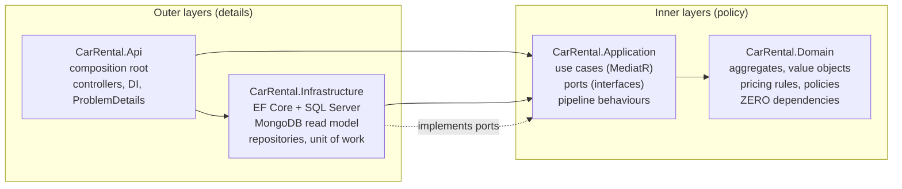
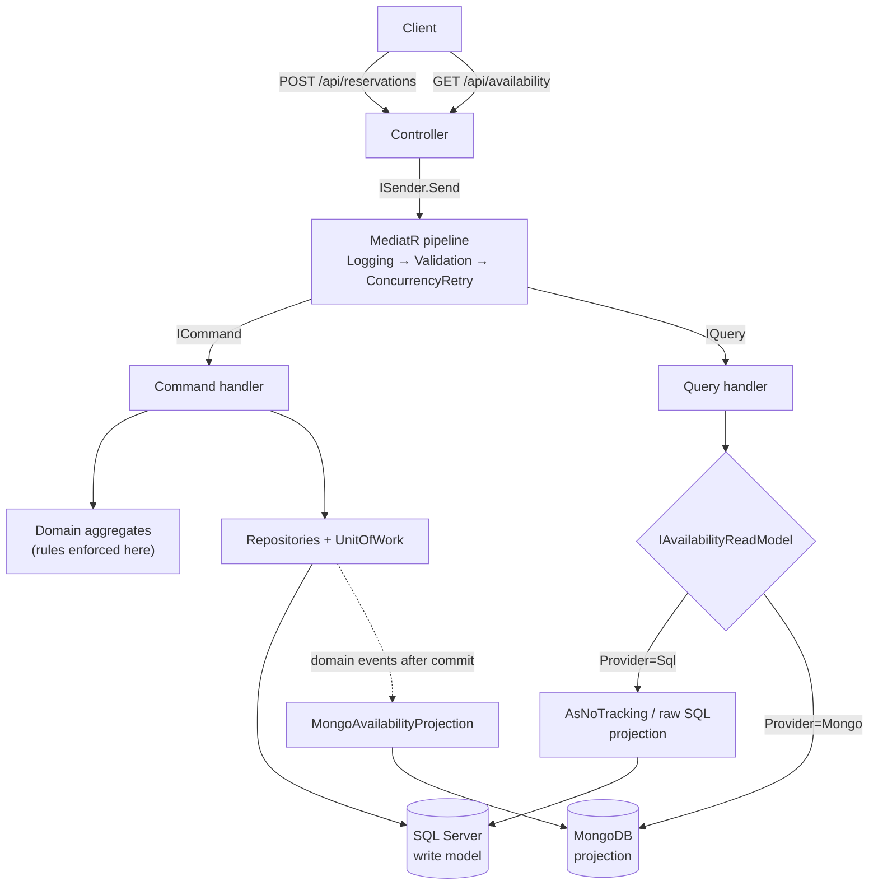
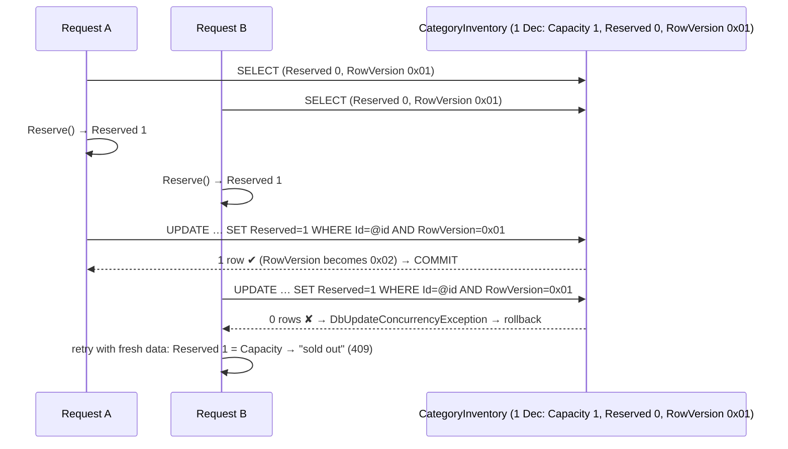
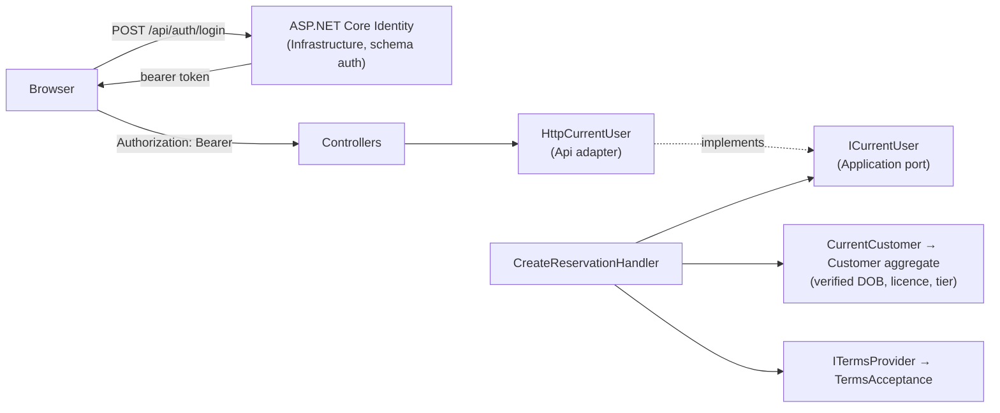
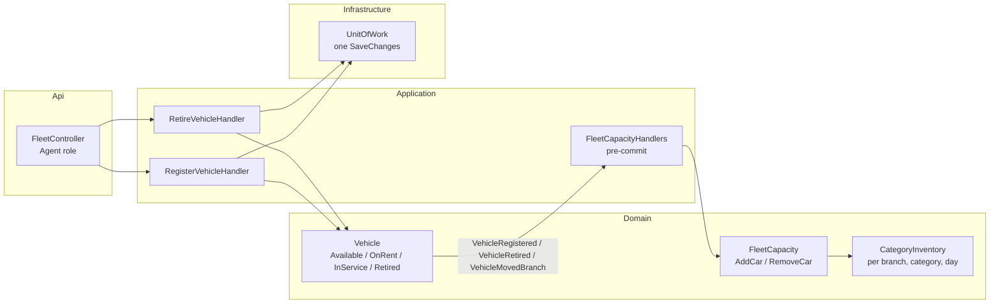
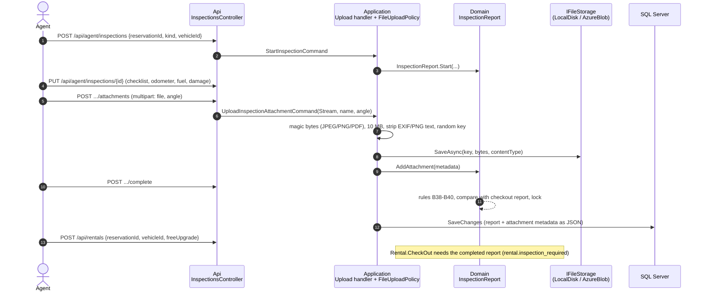
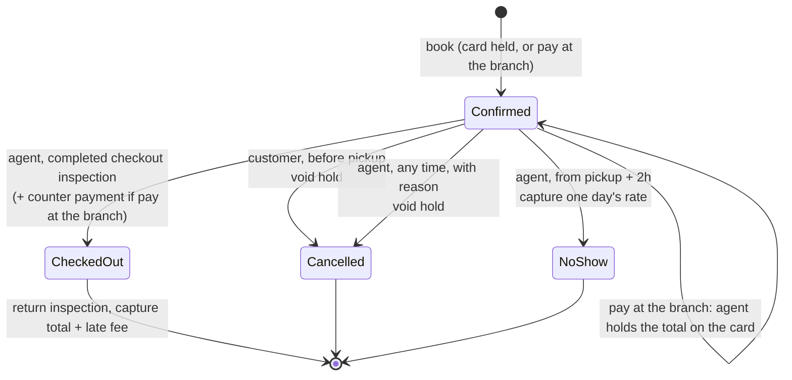

# Architecture

**Design B: a Clean Architecture monolith with CQRS-lite.** One deployable unit, four projects, and
dependencies that only point inwards.

## 1. The layers and the Dependency Rule



| Project | Depends on | Contains | Must never contain |
|---|---|---|---|
| **Domain** | nothing | `Reservation`, `Rental`, `CategoryInventory`, `Money`, `RentalPeriod`, `IPriceRule`… | EF attributes, MediatR, HTTP, `DateTime.Now` |
| **Application** | Domain, MediatR, FluentValidation | commands/queries + handlers, ports (`IReservationRepository`, `IUnitOfWork`, `IAvailabilityReadModel`) | `DbContext`, SQL, Mongo, ASP.NET |
| **Infrastructure** | Application | `CarRentalDbContext`, fluent mappings, repositories, `UnitOfWork`, read models | business rules |
| **Api** | everything | `Program.cs` (DI wiring), thin controllers, exception→HTTP mapping | business rules |

The rule is **enforced by tests** in `tests/CarRental.ArchitectureTests`. If anyone adds EF Core to
the Domain, the build goes red.

## 2. CQRS-lite: two paths through the system



- **Commands** (`ICommand<T>`) go **through the Domain**: load aggregate → call a method that checks
  the invariants → save in one transaction → publish domain events.
- **Queries** (`IQuery<T>`) **bypass the Domain**: they read flat DTOs straight from a projection
  (`AsNoTracking` LINQ, `Database.SqlQuery<T>` raw SQL, or MongoDB). There are no invariants to
  protect when reading, so loading aggregates would only waste memory.
- **"Lite"**: one SQL database serves both sides by default. The MongoDB read model shows how the
  read side can move to its own store **without touching a single command**. Switch with
  `ReadModels__Provider=Mongo`.

## 3. The CreateReservation slice, step by step

```mermaid
sequenceDiagram
    autonumber
    participant Client
    participant API as ReservationsController
    participant P as MediatR pipeline
    participant H as CreateReservationHandler
    participant D as Domain
    participant U as UnitOfWork (EF Core)
    participant DB as SQL Server
    Client->>API: POST /api/reservations
    API->>P: Send(CreateReservationCommand)
    P->>P: ValidationBehavior (shape → 400)
    P->>H: Handle (inside ConcurrencyRetryBehavior)
    H->>D: RentalPeriod.Create, DriverProfile
    H->>D: RentalPricer.Quote (IPriceRule pipeline)
    H->>D: Reservation.Create (eligibility, pickup time → 422)
    H->>U: inventory.GetRangeAsync (one row per day)
    H->>D: InventoryAllocation.Reserve (sold out → 409)
    H->>U: SaveChangesAsync
    U->>DB: BEGIN; UPDATE CategoryInventory … WHERE RowVersion=@v (×N); INSERT Reservations; COMMIT
    alt another request changed a row first
        DB-->>U: 0 rows affected
        U-->>P: ConcurrencyConflictException
        P->>P: DiscardChanges, retry with fresh data (max 3)
    end
    U->>U: publish ReservationCreated (→ Mongo projection)
    H-->>API: CreateReservationResult (id + price lines)
    API-->>Client: 201 Created
```

## 4. How overbooking is prevented

The naive version is a **check-then-act race**: two requests both count "1 car left" and both insert.

The fix uses **one small aggregate per (branch, category, day)**: `CategoryInventory` with
`Capacity`, `Reserved` and a SQL Server **`rowversion`** concurrency token.



Defence in depth:

1. **Domain**: `CategoryInventory.Reserve()` refuses to exceed capacity.
2. **Optimistic concurrency**: the `rowversion` makes the second concurrent writer fail; the whole
   transaction (reservation insert included) rolls back.
3. **Database CHECK constraint**: `Reserved BETWEEN 0 AND Capacity`, so even raw SQL cannot overbook.
4. **Unique index** on (BranchId, Category, Date): never two rows for one day.

Why optimistic and not `SERIALIZABLE` / `UPDLOCK`? There are no locks held while the request does
its work, it scales across many API instances, and conflicts are rare (they only happen on the same
branch+category+day at the same instant). The retry behaviour removes the false failures.

Proven against a real SQL Server in `tests/CarRental.IntegrationTests/OverbookingTests.cs`
(8 parallel customers, capacity 2: never more than 2 reservations, inventory always matches).

## 5. Tactical DDD building blocks

| Building block | Here | Why |
|---|---|---|
| **Aggregate root** | `Reservation`, `Rental`, `CategoryInventory`, `Branch`, `Vehicle`, `InspectionReport`, `Payment`, `Customer` | Consistency boundary; private setters; changes only via methods that check rules |
| **Value object** | `Money`, `RentalPeriod`, `DriverProfile` | Immutable, compared by value, self-validating ("illegal states unrepresentable") |
| **Strongly typed ID** | `ReservationId`, `BranchId`… (`readonly record struct`) | The compiler stops you passing a `CustomerId` where a `ReservationId` is expected |
| **Domain service** | `RentalPricer`, `InventoryAllocation` | Logic that doesn't belong to one aggregate |
| **Policy** | `DriverEligibilityPolicy` | Pure function, trivially testable |
| **Domain event** | `ReservationCreated`, `ReservationCancelled`, `VehicleReturned` | Decouple side effects (read models, notifications) from the use case |
| **Strategy** | `IPriceRule` implementations | Open/Closed pricing |

**Reservation vs Rental**: separate aggregates on purpose. Different lifecycles (booking online vs
keys at the counter), different invariants, and many reservations never become rentals.

## 6. Persistence mapping (EF Core)

- **Fluent configuration only** (`Infrastructure/Persistence/Configurations`): no attributes on domain classes.
- **Owned types**: `Money`, `RentalPeriod`, `DriverProfile` map to columns on the owner's table.
- **Strongly typed IDs**: one model-wide convention (`ConfigureConventions`) with a `ValueConverter` per ID type.
- **Concurrency tokens**: a shadow `RowVersion` property (`IsRowVersion()`) on Reservation, Rental and
  CategoryInventory. Shadow means it exists in the table but **not** on the domain class.
- **Enums as strings** for readability; `[Flags] Extras` as int.
- **Check constraints** for invariants the database can also guard (odometer, inventory).
- **JSON columns** (`OwnsMany(...).ToJson()`) for collections that only ever travel with their
  aggregate: the inspection checklist, damage marks, new damage and attachment metadata, and the
  vehicle logbook. EF Core 8 does not allow a key on a JSON element, so those value objects never have
  a property called `Id` (`InspectionAttachment.AttachmentId`).

## 7. Identity, customers and terms



- **Sign-in is a detail.** Identity lives in Infrastructure with its own `AuthDbContext`; the
  Domain only stores an opaque `UserId` on `Customer`; the Application only sees `ICurrentUser`.
  Replacing Identity with Entra ID means changing DI, not use cases.
- **The request can't lie about the driver.** Age, licence and loyalty tier come from the
  `Customer` aggregate, whose invariants check the SA ID number (date, citizenship digit, Luhn) and
  that the date of birth matches it. The loyalty tier is only set by the business.
- **Ownership is part of the query**: the reservation read model joins `Customers` and filters by
  the signed-in user, so other people's bookings are "not found".
- **Terms are versioned.** `TermsAcceptance.Accept(accepted, current, now)` rejects missing or old
  versions; the accepted version and time are stored on the reservation as an owned type.

## 8. Errors

| Exception | HTTP | Example code |
|---|---|---|
| `ValidationException` (FluentValidation) | 400 | `validation.failed` + field errors |
| `UnauthenticatedException` / `[Authorize]` | 401 | `auth.required` |
| wrong role | 403 | |
| `NotFoundException` | 404 | `resource.not_found` |
| `PaymentDeclinedException` | 402 | `payment.declined` (+ `reason`) |
| `CapacityExceededException` | 409 | `inventory.sold_out` |
| `ConcurrencyConflictException` | 409 | `concurrency.conflict` |
| `DomainException` | 422 | `eligibility.under_age`, `terms.not_accepted`, `customer.birth_date_mismatch` |

All responses are RFC 7807 `ProblemDetails` with a stable `code` for clients to switch on.

## 9. Card payments (mock gateway)

The usual card flow: **authorise** (hold) at booking, **capture** (take) when the car comes back,
**void** (release) when the booking is cancelled. The `Payment` aggregate owns the rules; the
gateway is a port; the mock adapter is chosen by `Payments:Provider`.

```mermaid
sequenceDiagram
    autonumber
    participant B as Browser
    participant HF as Hosted fields<br/>(POST /api/payments/tokenize, mock)
    participant API as ReservationsController
    participant H as CreateReservationHandler
    participant D as Domain (Reservation, Payment)
    participant G as IPaymentGateway<br/>(MockPaymentGateway)
    participant DB as SQL Server
    B->>HF: card number, expiry, CVC (only here)
    HF-->>B: { token, brand, last4 }  (nothing stored or logged)
    B->>API: POST /api/reservations { trip, acceptedTermsVersion, paymentToken }
    API->>H: CreateReservationCommand (ReservationId fixed per request)
    H->>D: price, Reservation.Create, reserve inventory
    H->>G: AuthorizeAsync(token, total, key = reservationId:authorize)
    alt declined
        G-->>H: Declined (card_declined / insufficient_funds)
        H->>D: Payment.Authorize(...) throws payment.declined
        H-->>B: 402, nothing saved
    else approved
        G-->>H: Approved (gateway reference, brand, last4)
        H->>D: Payment.Authorize → Authorized
        H->>DB: ONE transaction: inventory + reservation + payment
        Note over H,DB: lost a race? retry re-runs with the SAME key,<br/>so the gateway returns the first hold
    end
    Note over B,DB: later…
    alt customer cancels before pickup
        H->>D: Reservation.Cancel, Payment.EnsureCanVoid
        H->>G: VoidAsync(reference, key = reservationId:void)
        H->>DB: commit (Voided)
    else agent takes the return
        H->>D: Rental.Return → late fee; Payment.EnsureCanCapture(total + fee) (≤ hold + 15%)
        H->>G: CaptureAsync(reference, total + fee, key = reservationId:capture)
        H->>DB: commit rental + payment (Captured)
    end
```

- **PCI scope stays with the gateway.** The Domain only knows `CardSummary` (brand + last four);
  the database has no card columns; the tokenize endpoint is outside MediatR so the logging
  pipeline never sees card data.
- **Idempotency** comes from the reservation id, chosen when the command is created
  (`CreateReservationCommand.ReservationId`), so `ConcurrencyRetryBehavior` re-runs reuse the key.
- **Decline vs failure.** A declined *authorisation* stops the booking (402). A declined *capture*
  or *void* does not undo the return or the cancellation: the payment becomes `Failed` with the
  reason, for the back office to follow up.

## 10. The staff counter ("Roam Staff")

- `GET /api/account/me` returns email + roles from the token; the client uses it to route staff to
  `#/agent/*`. Every `/api/agent/*` endpoint and `/api/rentals` requires the Agent role.
- Counter queries use their own read-model port, `ICounterReadModel`, with **no owner filter**
  (agents serve any customer). The customer port, `IReservationReadModel`, keeps its owner filter, so
  the two can never be mixed up by accident.
- "A day" at the counter is SAST (all branches are in South Africa, UTC+2, no daylight saving).
- Walk-in customers: `IUserAccounts` creates the Identity user with a temporary password; the
  handler checks every `Customer` rule first so a rejected ID never leaves an orphan account.

## 11. Fleet: cars, status and capacity

Until this feature, `CategoryInventory` capacity was a seeded number. Now **capacity is counted from
the fleet**: a `Vehicle` aggregate per car (plate, VIN, category, home and current branch, odometer,
status, logbook), and every change that adds or removes a car at a branch adjusts the capacity of
that (branch, category) for every future day **in the same transaction**.



- The events are dispatched as `DomainEventRaised<T>` **before** `SaveChanges`, so the vehicle and the
  capacity change commit together (or not at all). Post-commit events (`DomainEventNotification`)
  still drive the read models.
- Retiring a car that customers already hold (reserved = capacity on some day) is refused with
  `inventory.capacity_below_reserved`: the business must reassign those bookings first.
- A one-way return moves the car (`VehicleMovedBranch`): one less at the pickup branch where possible,
  one more at the return branch.
- Car history (`GET /api/agent/vehicles/{id}/history`) is a read-model query that merges the logbook
  with the car's rentals and their inspection summaries, newest first.

## 12. Inspections and uploaded files

Checkout and return are now **evidence-based**: no keys without a completed checkout report, no
return without a completed return report. The report is its own aggregate (`InspectionReport`), one
per (reservation, kind).



- **The Domain never sees bytes.** Only the Api reads `IFormFile` (it hands the Application a
  `Stream`), and only Infrastructure touches the disk or a cloud SDK; architecture tests enforce both.
- **Files are untrusted input.** The type is decided from the content, never the extension or the
  browser's Content-Type; SVG and HTML are not accepted at all. The storage key is random; the user's
  file name is display metadata only.
- **Downloads are authorised per request** (`GET /api/inspections/{id}/attachments/{attachmentId}`):
  staff always; the customer only for a **completed** report of **their own** booking; everyone else
  gets 404. The response sets `X-Content-Type-Options: nosniff`, `Cache-Control: private, no-store`,
  a `sandbox` CSP and `Content-Disposition` (inline for images, attachment for PDFs). The React client
  fetches photos with the bearer token and shows them as object URLs.
- **Completed reports are locked**: no update, upload or removal afterwards (`inspection.locked`).
- `Files:Provider = Local` writes under `Files:LocalRoot` (default `App_Data/uploads`, outside
  `wwwroot`). `AzureBlob` is a deliberate placeholder for production (private container, managed
  identity, short-lived SAS or proxied downloads, malware scanning).

## 13. Reservation lifecycle (cancellation and no-show)



- All three endings that free the car (customer cancel, agent cancel, no-show) go through one
  Application service, `BookingRelease`: release the inventory days, then void the hold or capture the
  no-show fee. One place, so a new way of ending a booking can't forget the inventory or the card.
- `CancellationDetails` records who (customer or agent user id), why and when; the customer's DTO
  says only "Customer" or "Agent" plus the reason, never the agent's id.
- **Pay at the branch** skips step 7 of CreateReservation (no gateway call, no Payment row). At the
  counter `TakeCounterPayment` creates the same `Payment` a card booking gets online (Authorized for
  the booking total), so return, capture, late fee and cancellation need no special cases. The only
  new rule is in `Rental.CheckOut`: a pay-at-branch booking needs that Authorized hold (B47).
- The no-show fee is a Domain policy (`INoShowFeePolicy`, currently `OneDayRateNoShowFee`: one day's
  rate, at most the booking total), so the business can change it without touching the use case.

## 14. Known trade-offs and next steps

| Choice in this PoC | Production upgrade |
|---|---|
| Domain events published in-process after commit | **Transactional outbox** + background dispatcher (no lost events) |
| `EnsureCreated` + seed in Development | **EF Core migrations** applied by the pipeline (migration bundle) |
| Daily inventory granularity (conservative) | Hourly slots, or allocate specific vehicles |
| Inventory rows pre-planned by a seed | A scheduled fleet-planning job |
| Commands double as HTTP request bodies | Separate versioned API contracts |
| Mongo projection uses `$inc` | Idempotent projection (store processed event IDs) for at-least-once delivery |
| ASP.NET Core Identity bearer tokens, keys in memory | Persist Data Protection keys, or Entra ID / JWT; MFA |
| Terms text in code (`StaticTermsProvider`) | Terms from a CMS/table, published by legal without a deploy |
| ID numbers stored in plain columns | Always Encrypted / column encryption (POPIA) |
| No idempotency key on POST | `Idempotency-Key` header so client retries can't double book (the card is already safe: the reservation id is the gateway key, and a client may send `reservationId`) |
| Capture allows only **15% over the hold**, but a late day costs 1.5× the daily rate, so a short booking returned late exceeds it and the return is refused (`payment.capture_exceeds_authorization`) | Authorise a deposit on top of the total, or capture the hold and charge the balance as a separate sale. The rule is kept strict as specified; the staff UI explains the error |
| A booking that authorised the card but then failed to commit (sold out after retries) leaves the hold to expire at the bank | A compensating void after a failed commit, or a reconciliation job against the gateway |
| Mock gateway keeps idempotency keys in memory (lost on restart); captures/voids approve any reference it issued | A real gateway keeps keys server-side; a real adapter (Peach, PayFast, Stripe, Adyen) behind `Payments:Provider` |
| `/api/payments/tokenize` (mock hosted fields) runs on our API | The gateway's hosted fields / JS SDK on the gateway's domain; the endpoint is deleted |
| **Agents have no home branch**: any agent can check out any branch's car; the staff app's branch is a UI filter | An `AgentBranch` claim and a Domain rule (`rental.wrong_branch`), tested like the others |
| Walk-in customer: Identity user and Customer are saved by two DbContexts; a crash between them leaves an account without a profile (the customer can complete it on sign-in) | Shared transaction (same connection) or an invitation flow; emailed invitation link instead of a temporary password |
| `DemoClock:Offset` (Development only) shifts "now" for demos | Not used outside Development |
| Uploaded files on local disk (`Files:Provider = Local`); `AzureBlob` is a placeholder | Private Blob container with managed identity, malware scanning (Defender for Storage) before a file is visible, lifecycle/retention rules |
| Upload is buffered in memory (≤ 10 MB) to check and strip metadata | Stream to a quarantine container and process asynchronously for larger files or video |
| Upload stores the file, then saves the report; if the save fails the handler deletes the file, but a crash between the two leaves an orphan | Metadata first as "pending", or a clean-up job for keys with no metadata |
| Damage is free text with a panel name | A car diagram with clickable panels and severity codes for claims/insurance |
| The customer acknowledges a report in the app; no signature | A signature pad at the counter, or a signed PDF emailed to the customer |
| Pay at the branch: an unpaid booking that is a no-show can't be charged the no-show fee, and it holds a car without any card | A card-on-file guarantee (zero-value authorisation) at booking, or limit pay-at-branch to customers with a good history |
| Counter payment uses the gateway's hosted fields on the agent's screen | A card terminal integration (card present, PIN/contactless), which also lowers fraud risk |
| No-show and cancellation are manual staff actions | A scheduled job that flags no-shows after pickup + 2h, and notifications (email/SMS) on cancel |
